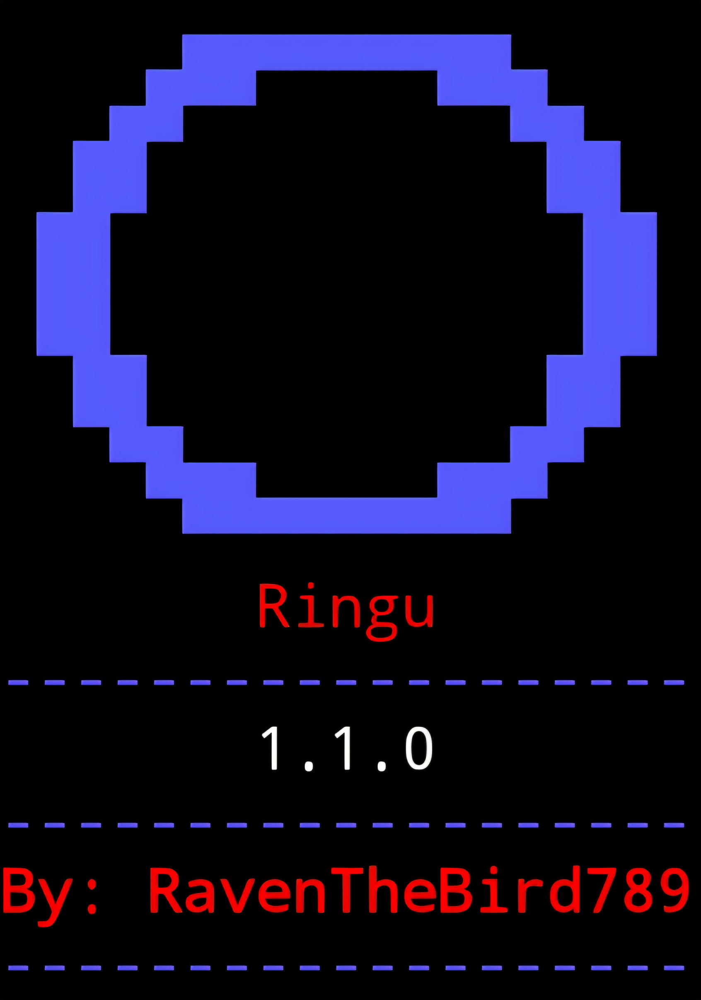

# Ringu
Ring device detection tool — v1.1.0



Requirements:
* Ensure that the latest version of python is installed in your terminal (python 3.9+)
* `scapy` for Wi-Fi scanning (can be installed from requirements.txt)
* A wireless adapter that supports monitor mode for Wi-Fi scanning, already switched into monitor mode (ex: `sudo airmon-ng start wlan0`)
* Root privileges for Wi-Fi packet capture
* A Linux OS or VM (the current version of Ringu isn't supported on Windows or macOS)

Installation & setup

````bash
git clone https://github.com/RavenTheBird789/Ringu
cd Ringu
python3 -m venv env
source env/bin/activate
pip install -r requirements.txt
````

To run

````bash
sudo python3 ringu.py --wifi-iface <your_interface_name>
````

Options

````bash
-h, --help         Show this help message and exit
-d, --duration     Scan time in seconds (default: 30)
--wifi-iface       Wi-Fi interface already in monitor mode (ex: wlan0mon) (required)
-o, --output       Export results to a CSV file
````

Example:

````bash
# 20 second scan with CSV export
sudo python3 ringu.py --wifi-iface wlan0mon -d 20 -o scan.csv
````

How detection works:

Ringu checks for Ring devices in two ways:
* **AP mode** — catches a Ring device while it's broadcasting its own network, which typically only happens briefly during initial setup/pairing (e.g. an SSID like `Ring-XXXXXX`)
* **Connected client mode** — catches a Ring device already joined to a home Wi-Fi network, by passively reading its MAC address out of the (unencrypted) 802.11 header of data frames it sends/receives. This works even under WPA2, since Wi-Fi encryption only covers the frame payload, not the MAC header

Both methods match against a hardcoded list of known Ring MAC OUIs (manufacturer prefixes). A device is flagged if either its MAC OUI matches the list, or (AP mode only) its broadcast SSID contains "Ring".

Notes:
* You must pass `--wifi-iface` for Ringu to run
* The interface must already be in monitor mode, the script does not switch it for you
* The Wi-Fi scan is passive and never transmits
* Ringu currently scans on a single fixed channel and does not channel-hop. If the target device's network is on a different channel than your adapter, it will not be detected — regardless of distance. Manually setting your adapter to the correct channel beforehand (or scanning longer on a known channel) improves odds
* The OUI list is a fixed, manually curated set and may not cover every Ring hardware generation or manufacturer range — a non-match doesn't guarantee a device isn't a Ring product
* Devices using MAC address randomization will not match OUI-based detection, regardless of scan conditions
* Client-mode detection depends on the device actively transmitting (e.g. motion-triggered recording, live view, periodic heartbeat traffic) during the scan window — an idle device may not generate traffic to detect
* Detection is substantially less reliable from a moving vehicle than standing still, due to shorter dwell time and lower chances of channel/timing alignment
* KeyboardInterrupt (Ctrl + C) can be used to stop the scan early, the summary will still print and the CSV will still export with whatever was found
* CSV columns are `mac_addr, ssid, rssi, channel, source` (`source` indicates whether the match came from `beacon/probe-resp` or `data-frame`; `ssid` and `channel` are only populated for AP-mode matches)
* If no duration is provided, the default is 30 seconds
